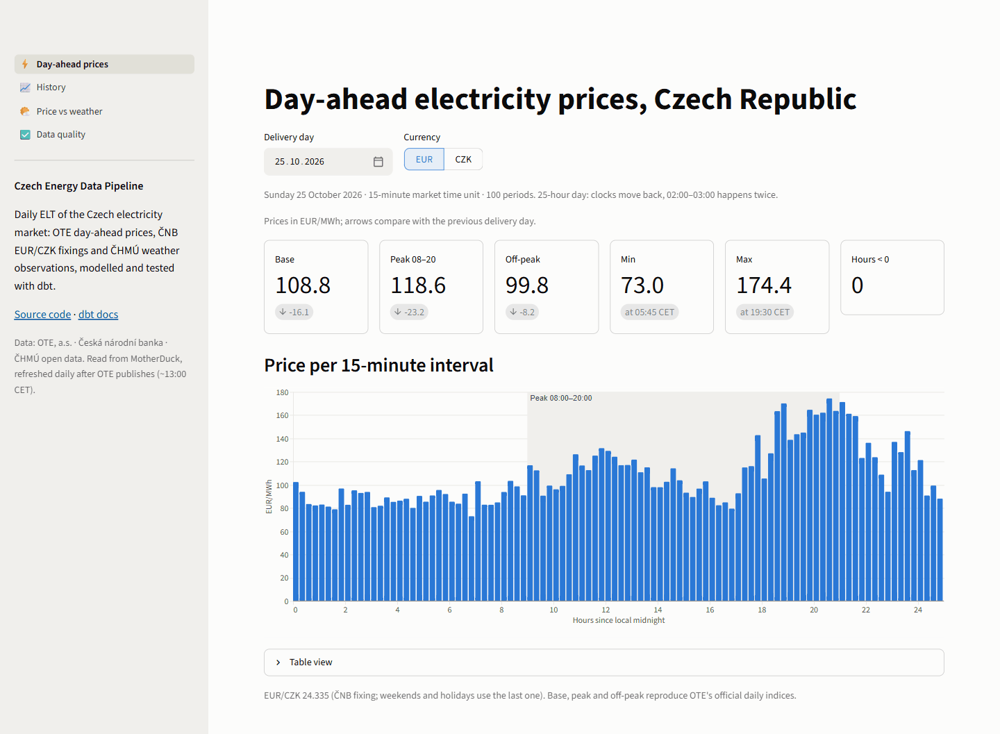
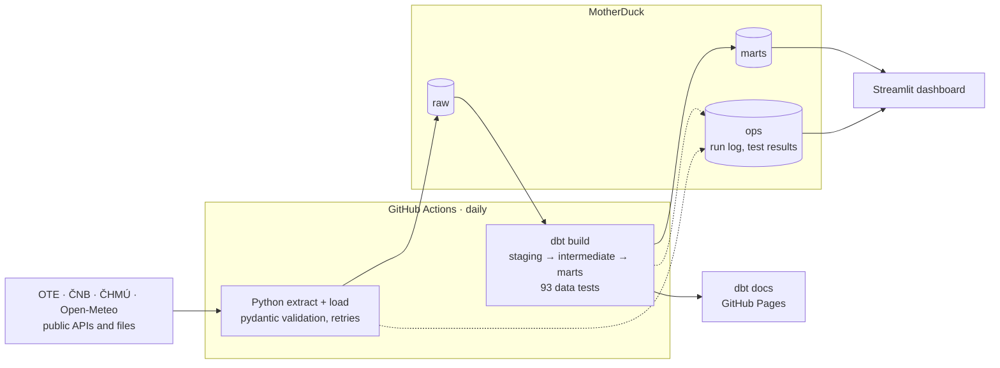
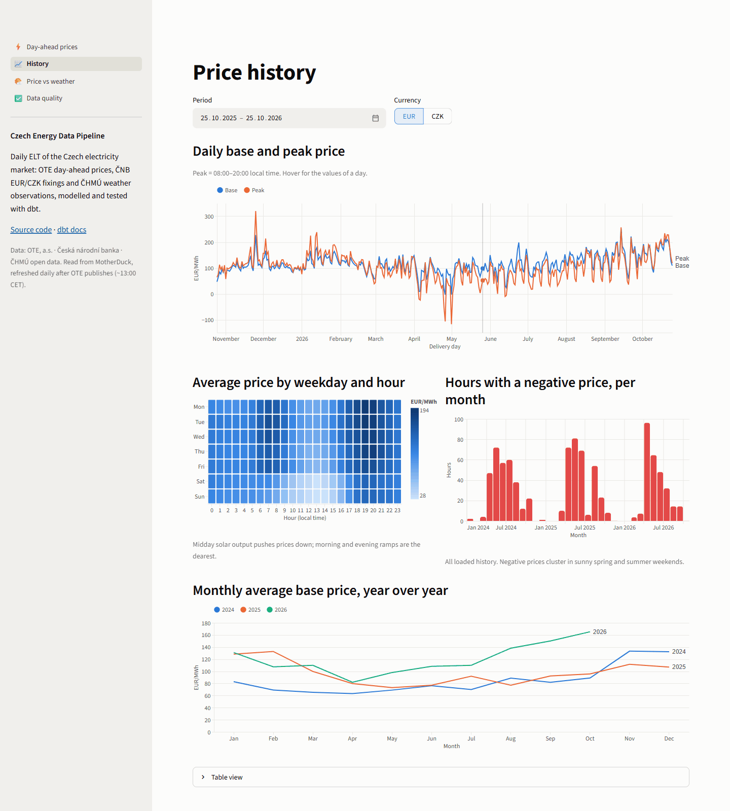
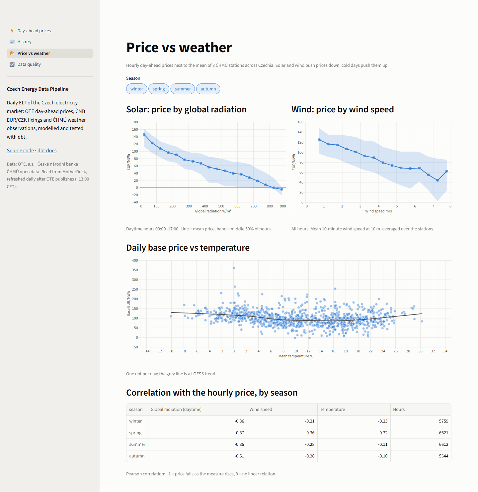
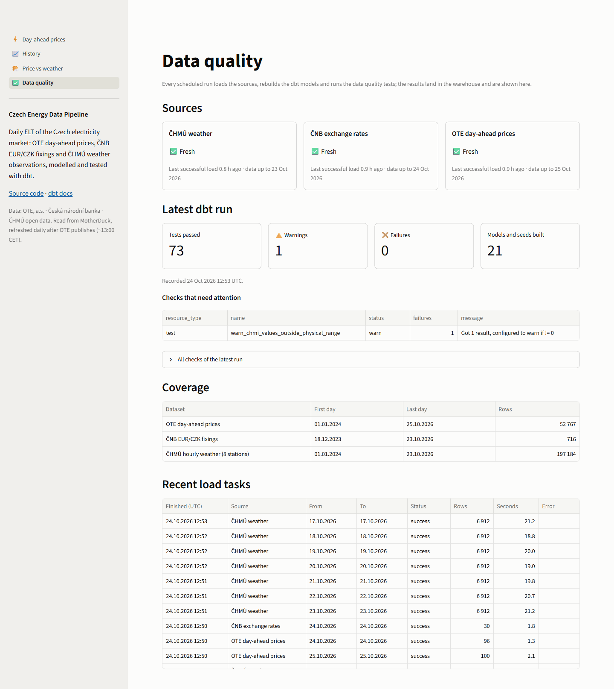

# Czech Energy Data Pipeline

[](https://github.com/maksympostoiuk/czech-energy-pipeline/actions/workflows/ci.yml)
[](https://github.com/maksympostoiuk/czech-energy-pipeline/actions/workflows/daily.yml)

A production-style ELT pipeline for the Czech electricity market. Every day it loads
**day-ahead prices from OTE**, **EUR/CZK fixings from ČNB**, **weather observations from
ČHMÚ** and **weather forecasts as issued before the auction from Open-Meteo**, models them
with **dbt** on **DuckDB / MotherDuck**, checks them with **93 dbt data tests plus source
freshness**, including a reconciliation with OTE's official reports, and publishes a **Streamlit**
dashboard. GitHub Actions runs everything on a schedule, at zero cost.

**[Live dashboard](https://czech-energy-prices.streamlit.app/)** ·
**[dbt docs and lineage](https://maksympostoiuk.github.io/czech-energy-pipeline/)** ·
**[Design decisions](docs/decisions.md)** ·
**[Data sources](docs/sources.md)**



## At a glance

- **Sources:** OTE day-ahead market (CZ bidding zone), ČNB exchange rate fixing, 8 ČHMÚ weather stations (10-minute data), Open-Meteo forecasts (DWD ICON-EU) for those stations and 6 German solar and wind regions
- **History:** since 1 January 2024: ~52,000 market periods, ~7.1 million weather observations, updated daily
- **Stack:** Python 3.12 · httpx · pydantic · DuckDB / MotherDuck · dbt-core + dbt-duckdb · GitHub Actions · Streamlit · uv · ruff · pytest
- **Quality:** 93 dbt data tests + source freshness, 113 pytest tests, CI on every push; daily indices equal OTE's official figures to the cent

## Architecture



1. **Extract + load (Python).** One extractor per source validates every response with pydantic and fails loudly on a changed format. Loads are idempotent upserts on natural keys, and every task is logged in `ops.pipeline_runs`.
2. **Transform (dbt).** `staging` derives DST-safe UTC and local times. `intermediate` converts prices to CZK and builds an hourly national weather signal. `marts` hold the facts and dimensions the dashboard reads.
3. **Test.** Source freshness, keys, ranges, completeness, cross-source checks and a reconciliation with OTE's published daily reports. Results are stored in the warehouse and shown on the dashboard.
4. **Serve.** A Streamlit dashboard reads MotherDuck with a read-only token, and dbt docs are published to GitHub Pages.

## Engineering highlights

| Challenge | How it is handled |
|---|---|
| The market moved from **hourly to 15-minute** products on 2025-10-01 | Facts keep the traded market time unit (`mtu_minutes`); an hourly fact is derived for comparisons across the switch |
| **Daylight saving time**: 23/25-hour days, 92/100 periods, a repeated 02:00 | Period start = local midnight converted to UTC + offset; every session runs in UTC; tests pin the period counts |
| OTE's endpoint is **undocumented** | Strict validation (series, period count, date); a real gap (2025-07-04, hours 13–24 missing at the source) was caught and allowlisted with evidence |
| ČHMÚ publishes **unchecked data first**, and deletes it after a few days | Prefer the quality-checked folder, fall back to the fresh one, reload the last 7 days daily; physically impossible values are excluded and reported |
| Re-runs and backfills must **never duplicate** | Transactional delete + insert on natural keys; uniqueness is asserted by dbt tests |
| Is the output actually **correct**? | Base / peak / off-peak prices and volumes are reconciled with OTE's official XLSX reports for 8 days, including all four DST day types |
| CI without data or network | Tests run on stored real API responses, `dbt build --empty` runs every model and test with zero rows, and the dashboard is rendered headlessly |

The reasoning behind each choice is in **[docs/decisions.md](docs/decisions.md)**.

## What the data shows

- **Solar sets the midday price.** Across all seasons, the average daytime price falls almost linearly from ~145 EUR/MWh in dull hours to about 0 at ~820 W/m² of global radiation.
- **Negative prices are now routine:** 315 hours in 2024, 323 in 2025 and 280 in 2026 to date. On 1 May 2026 the price hit the harmonised −500 EUR/MWh floor at midday.
- **Prices keep rising:** the average base price was 85.1 EUR/MWh in 2024, 97.0 in 2025 and 119.2 in 2026 to date.
- **Temperature has a U-shaped effect:** daily prices are higher on cold days and again on hot days, and lowest around 10–20 °C.

## Dashboard

| Page | What it shows |
|---|---|
| Day-ahead prices | price per 15-minute interval for any delivery day (EUR or CZK); base / peak / off-peak with the change vs the previous day; DST days labelled |
| History | daily base and peak, weekday × hour price profile, negative-price hours per month, year-over-year monthly prices |
| Price vs weather | price by global radiation and by wind speed (mean and inter-quartile range), daily price vs temperature, correlations by season |
| Data quality | freshness per source, results of the latest dbt run, coverage, recent load tasks |

Charts use one colour-blind-safe palette checked with a validator. Every mark has a tooltip,
and multi-series charts carry direct labels and a table view.

<details>
<summary>More screenshots</summary>





</details>

## Data model

| Layer | Models | Materialization |
|---|---|---|
| reference (seeds) | Czech public holidays, selected stations, forecast points, physical ranges, known incomplete OTE days, official OTE indices for reconciliation | table |
| staging | `stg_ote__dam_prices`, `stg_cnb__fx_rates`, `stg_chmi__observations`, `stg_chmi__stations`, `stg_openmeteo__forecasts`, `stg_ops__pipeline_runs`, `stg_ops__dbt_results` | view |
| intermediate | `int_fx_eur_czk_daily`, `int_dam_prices_czk`, `int_weather_hourly_station`, `int_weather_hourly_cz` | view |
| marts | `dim_date`, `dim_station`, `fct_dam_prices` (incremental), `fct_dam_prices_hourly`, `fct_daily_market_summary`, `mart_price_vs_weather` | table |

Column-level documentation and the lineage graph are in the
[dbt docs](https://maksympostoiuk.github.io/czech-energy-pipeline/).

## Data quality

| Check | Examples |
|---|---|
| Source freshness | every source loaded within 26 h (warn) / 50 h (error) |
| Keys and relationships | composite natural keys unique; stations and dates exist in dimensions |
| Ranges | prices within SDAC limits (dbt vars), EUR/CZK 20–30, physical weather ranges from a seed |
| Completeness | all 92 / 96 / 100 periods per day, no missing delivery days, every UTC hour fully covered |
| Cross-source | weekdays without a ČNB fixing are exactly the Czech public holidays |
| Reconciliation | daily prices and volumes equal OTE's official reports on 8 sample days |
| Operations | load tasks whose last attempt failed (warn) |

Every check was verified by sabotaging a copy of the warehouse with duplicates, out-of-range
values, missing periods and days, a missing ČNB fixing and a silently changed price. Each
failure was caught, and a failing staging test stops the marts from being rebuilt.

The checks also surfaced three real issues in the sources:

- OTE published only hours 1–12 for 2025-07-04.
- On hourly-market DST days, OTE's own reports sum peak volume by hour position, while peak price uses clock time.
- ČHMÚ delivered a physically impossible global radiation of 1673.7 W/m² flagged as good quality.

## Run it locally

Requires [uv](https://docs.astral.sh/uv/).

```bash
uv sync                                       # Python 3.12 and all dependencies
cp .env.example .env                          # local settings; secrets stay out of git
uv run pytest                                 # 113 tests, no network needed
uv run pipeline backfill --from 2024-01-01    # history into data/warehouse.duckdb (~15 min)
cd dbt && uv run dbt deps && uv run dbt build && cd ..
uv run streamlit run dashboard/app.py
```

| Command | What it does |
|---|---|
| `pipeline run --date 2026-10-21 [--source ote]` | load one business date |
| `pipeline daily` | the scheduled run: tomorrow's and today's prices, today's fixing, the last 7 days of weather |
| `pipeline backfill --from … [--to …] [--resume]` | load a period; `--resume` skips periods that already loaded |
| `pipeline init` | create the raw and ops schemas |
| `pipeline record-dbt-results <artifacts>` | store dbt results in `ops.dbt_results` |

## Production setup

| Workflow | Trigger | What it does |
|---|---|---|
| `ci.yml` | push to `main`, pull requests | ruff, pytest, `dbt build --empty`, dashboard render test |
| `daily.yml` | 14:17 and 16:47 UTC, manual | `pipeline daily` → `dbt source freshness` → `dbt build` → results into `ops.dbt_results` |
| `backfill.yml` | manual | `pipeline backfill` → `dbt build --full-refresh` |
| `docs.yml` | changes in `dbt/`, manual | `dbt docs generate --static` → GitHub Pages |

One-time setup:

1. Create a MotherDuck account (free Lite plan) and a read/write token. Add it as the repository secret `MOTHERDUCK_TOKEN`.
2. In Settings → Pages, set Source to **GitHub Actions**.
3. Run **Backfill** once, then **dbt docs**.
4. Deploy the dashboard on Streamlit Community Cloud. Use main file `dashboard/app.py`, Python 3.12, and a read-only MotherDuck token in Secrets as `MOTHERDUCK_TOKEN = "…"`.

MotherDuck supports DuckDB up to 1.5.x, so `duckdb` is pinned to `<1.6`. GitHub disables
scheduled workflows after 60 days without repository activity; if that happens, re-enable
**Daily load** in the Actions tab.

## Repository layout

```
src/energy_pipeline/   extract (ote, cnb, chmi, openmeteo), load (warehouse, dbt results), pipeline, CLI
dbt/                   models (staging, intermediate, marts), seeds, singular tests
dashboard/             Streamlit app: data access, charts, four pages
tests/                 pytest suite and stored real API responses (fixtures/)
scripts/               fetch_fixtures.py (refresh stored API responses), compare_forecast_models.py (forecast skill vs ČHMÚ)
docs/                  sources.md, decisions.md, PLAN.md and FORECAST_PLAN.md (plans, in Russian), images/
.github/workflows/     ci, daily, backfill, docs
```

## Data sources

- **OTE, a.s.:** day-ahead market results for the Czech bidding zone ([ote-cr.cz](https://www.ote-cr.cz/))
- **Česká národní banka:** exchange rate fixing ([api.cnb.cz](https://api.cnb.cz/))
- **ČHMÚ:** climatological open data ([opendata.chmi.cz](https://opendata.chmi.cz/))
- **Open-Meteo:** archived DWD ICON-EU forecasts, CC BY 4.0. Weather data by [Open-Meteo.com](https://open-meteo.com/)

This is an independent portfolio project, not affiliated with any of these institutions. See
[docs/sources.md](docs/sources.md) for endpoints, formats and known quirks.
