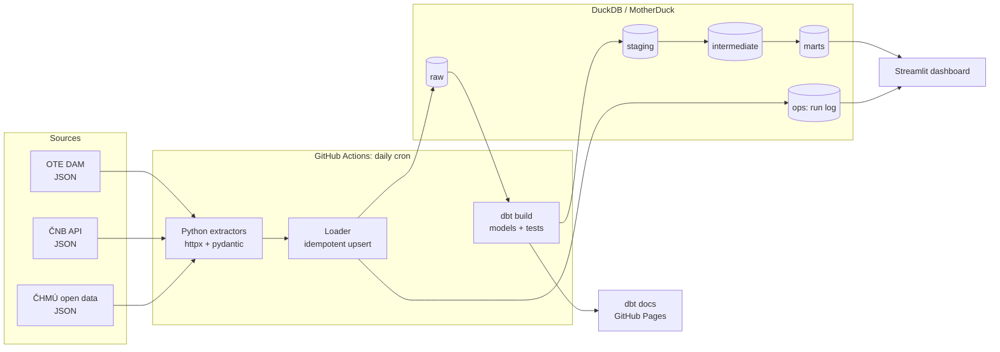

# Czech Energy Data Pipeline: архитектура и план

## 1. Что мы строим

Production-like пайплайн данных, который **каждый день сам** собирает данные чешского энергорынка, складывает их в аналитическое хранилище, преобразует через dbt в чистые витрины, проверяет качество данных и показывает результат на публичном дашборде.

**Бизнес-вопросы, на которые отвечает система:**

- Сколько стоит электроэнергия в Чехии завтра, по 15-минутным интервалам, в EUR и CZK?
- Как цена зависит от погоды: солнца (солнечная генерация), ветра, температуры (отопление)?
- Где пиковые и «отрицательные» часы, как меняется спред peak/off-peak, как цена ведёт себя по дням недели и сезонам?
- Насколько свежие и корректные данные (страница Data Quality прямо в дашборде)?

**Что это доказывает работодателю:** ETL на Python, моделирование данных (staging → intermediate → marts, звёздная схема), SQL, dbt (тесты, документация, инкрементальные модели), CI/CD на GitHub Actions, качество данных и наблюдаемость. Плюс знание предметной области: DAM, SDAC, 15-минутный MTU, CET/CEST, ČNB fixing.

## 2. Источники данных (проверено 2026-10-22)

> Подробная спецификация по итогам этапа 1 лежит в [sources.md](sources.md): эндпоинты, форматы, граничные случаи, станции, стратегия загрузки.

| Источник | Что берём | Как | Особенности |
|---|---|---|---|
| **OTE, a.s.** (ote-cr.cz) | Результаты денного рынка (DAM): цена EUR/MWh и объём MWh | JSON `https://www.ote-cr.cz/pw-data/chart-data/01?language=en&report_date=YYYY-MM-DD` (запасной вариант: XLSX-отчёты OTE) | С 1.10.2025 рынок работает в **15-минутных** интервалах: 96 точек в день, 92 или 100 в дни перехода на летнее/зимнее время. Время локальное (Europe/Prague). Результаты публикуются около 13:00 CET за следующий день. Endpoint неофициальный, поэтому парсер должен падать громко, если формат поменяется |
| **ČNB** | Официальный курс EUR/CZK (и, при желании, USD/CZK) | REST `https://api.cnb.cz/cnbapi/exrates/daily?date=YYYY-MM-DD&lang=EN` | Публикуется по рабочим дням после 14:30. На выходные и праздники курса нет, используем последний действующий курс (forward-fill в dbt) |
| **ČHMÚ** open data | 10-минутные наблюдения метеостанций: температура, ветер, глобальная солнечная радиация, солнечное сияние, осадки, влажность | `https://opendata.chmi.cz/meteorology/climate/now/data/10m-<WSI>-<YYYYMMDD>.json` + метаданные станций в `…/now/metadata/` | В `now/` лежат только **последние ~3 дня**: если пропустить запуск, данные пропадут. Свежие данные ещё не прошли контроль качества, поэтому каждый день перезагружаем последнюю неделю из `recent/`. Бэкфилл берём из `historical_csv/` (2018–2025, отдельный файл на каждый показатель) и `recent/{MM}/`. Используем 8 станций по всей стране |

## 3. Архитектура



### 3.1 Технологический стек

| Слой | Выбор | Почему |
|---|---|---|
| Язык | Python 3.12, менеджер `uv` | Быстро, воспроизводимо, стандарт 2026 года |
| HTTP и валидация | `httpx` + `tenacity` (ретраи) + `pydantic` (схемы ответов) | Контракт на входе: если API поменяет формат, увидим это сразу, а не в дашборде |
| Хранилище | **DuckDB** локально + **MotherDuck** (облачный DuckDB, free tier) в проде | Ноль инфраструктуры. GitHub Actions пишет, Streamlit Cloud читает одну и ту же базу. Тот же SQL-диалект локально и в облаке |
| Трансформации | `dbt-core` + `dbt-duckdb`, пакеты `dbt_utils`, `dbt_expectations` | Основная «звезда» проекта |
| Оркестрация | GitHub Actions (cron + workflow_dispatch с параметром даты) | Бесплатно, прозрачно, видно в репозитории |
| Качество кода | `ruff`, `pytest`, `sqlfluff`, `pre-commit` | Всё прогоняется в CI на каждый PR |
| Дашборд | Streamlit + Plotly, деплой на Streamlit Community Cloud | Публичная ссылка для резюме |

> **Альтернатива: PostgreSQL** (Neon или Supabase, free tier). Выглядит «энтерпрайзнее», но требует сервер, миграции и `dbt-postgres`. Архитектура почти не меняется: меняется только adapter и loader. Рекомендую DuckDB + MotherDuck, а в README отдельно объяснить этот выбор: умение обосновать решение ценится на собеседовании.

### 3.2 Слои данных

**`raw`**: данные как пришли (провалидированы pydantic, приведены к колонкам), плюс `_run_id` и `_ingested_at`. Пишет только Python ([warehouse.py](../src/energy_pipeline/load/warehouse.py)).

- `raw.ote_dam_results`: delivery_date, period (1..100), mtu_minutes (15/60), price_eur_mwh, price_60min_ref_eur_mwh, volume_mwh
- `raw.cnb_fx_rates`: valid_for, currency_code, amount, rate, country, currency
- `raw.chmi_observations`: station_id, element, observed_at (TIMESTAMPTZ, UTC), value (NULL = пропуск), flag, quality, source_folder (recent/now)
- `raw.chmi_stations`: метаданные всех станций ČHMÚ (координаты, высота, название)
- `ops.pipeline_runs`: run_id, source, business_date, status (success/no_data/failed), rows_loaded, started_at, finished_at, error

Загрузка **идемпотентна**: в одной транзакции удаляются строки с тем же естественным ключом (например `delivery_date + period`), затем вставляются новые. Так безопасны ретраи, перезагрузка недели ČHMÚ и бэкфилл. PRIMARY KEY на raw-таблицах намеренно нет: DuckDB проверяет ограничения сразу, и DELETE + INSERT одного ключа в одной транзакции падает. Уникальность проверяют тесты dbt.

> **Часовой пояс:** DuckDB по умолчанию берёт TimeZone компьютера (у нас Europe/Prague), поэтому `observed_at::date` даёт местную дату, а не UTC. Загрузчик и dbt явно ставят `SET TimeZone = 'UTC'`, а локальное время считается только явным `AT TIME ZONE 'Europe/Prague'`.

**`reference`** (dbt seeds): `czech_public_holidays` (сверено с календарём ČNB: будни без фиксинга = праздники), `chmi_stations_selected`, `ote_known_incomplete_days`. Совпадение двух последних со списками в Python проверяет pytest.

**`staging`** (dbt, view): одна модель на одну сырую таблицу. Переименование, типы, единицы измерения, часовые пояса (местное время Europe/Prague → UTC + local), дедупликация.

- `stg_ote__dam_prices`, `stg_cnb__fx_rates`, `stg_chmi__observations`, `stg_chmi__stations`, `stg_ops__pipeline_runs`

**`intermediate`** (dbt, view): бизнес-логика.

- `int_fx_eur_czk_daily`: календарь × курс EUR/CZK с forward-fill на выходные, праздники и «завтра»
- `int_dam_prices_czk`: цены в CZK/MWh, местный час, флаг peak (08:00–20:00)
- `int_weather_hourly_station`: 10-минутные наблюдения → часовые агрегаты по станции
- `int_weather_hourly_cz`: среднее 8 станций по часу, национальный погодный сигнал

**`marts`** (dbt, table/incremental): то, что читает дашборд.

- `dim_date`: календарь 2024–2027, госпраздники, сезон, длина дня (23/24/25 часов)
- `dim_station`: станции с регионом и координатами
- `fct_dam_prices`: зерно = один MTU, как торговался (60 мин до 30.09.2025, 15 мин после); incremental (delete+insert, перестраиваются последние 7 дней)
- `fct_dam_prices_hourly`: вся история в часовом зерне (по UTC-часу, поэтому повторный осенний 02:00 остаётся отдельной строкой)
- `fct_daily_market_summary`: base/peak/off-peak (до цента совпадают с официальными индексами OTE), min/max, спред, отрицательные цены, объём, курс, погода дня, флаги полноты
- `mart_price_vs_weather`: часовая цена + температура/ветер/радиация/солнце для анализа корреляций

### 3.3 Качество данных

| Уровень | Проверка |
|---|---|
| Python (на входе) | pydantic-схема ответа; непустой ответ; ожидаемое число интервалов с учётом DST; дата в ответе OTE = запрошенной |
| dbt source freshness | последняя загрузка каждого источника не старше 26 ч (warn) / 50 ч (error) |
| Recency (тег `freshness`) | цены на сегодня есть; после 14:00 есть цены на завтра (warn); курс ČNB не старше 5 дней; метеоданные не старше 30 ч (warn) |
| dbt generic + dbt_utils | `unique`, `not_null`, `relationships`, `accepted_values`, уникальность составных ключей, непрерывность дат (`sequential_values`), логические инварианты (`expression_is_true`) |
| dbt_expectations | цена в лимитах SDAC (−500…+4000 EUR/MWh, из vars); объём ≥ 0; EUR/CZK 20…30; конец интервала > начала |
| Физические диапазоны | seed `chmi_measure_ranges`: невозможные значения не попадают в агрегаты, тест с уровнем warn выводит их список для аудита |
| Полнота | каждый день содержит все 92/96/100 (23/24/25) периодов, кроме официально неполных; каждый час UTC полностью покрыт периодами; у станций ≥ 22 часов данных в сутки (warn) |
| Перекрёстные проверки | будни без фиксинга ČNB = госпраздники; список «неполных дней» OTE не устарел |
| **Сверка с первоисточником** | base/peak/off-peak и объёмы совпадают с официальными отчётами OTE за 8 дней (оба режима рынка, все типы DST-дней, отрицательная база) |
| Наблюдаемость | `ops.pipeline_runs`: незакрытые неудачные загрузки (warn); результаты `dbt build` → страница Data Quality в дашборде; упавший workflow = письмо от GitHub |

**Проверено поломкой копии базы:** дубль строки, цена выше лимита, отрицательный объём, пропуск фиксинга ČNB, пропуск четверти часа, пропуск дня, невозможная температура, неудачная загрузка, тихое изменение одной цены на 1 EUR. Всё поймано. Ошибки в staging останавливают сборку зависимых витрин, и плохие данные до дашборда не доходят.

**Находки в реальных данных:** (1) OTE за 04.07.2025 опубликовал только часы 1–12; (2) в отчётах OTE за почасовые DST-дни peak-объём считается по позициям часов 9–20, а peak-цена — по настенным часам; (3) ČHMÚ, Голешов, 22.09.2026 09:50 UTC: радиация 1 673,7 W/m² с кодом качества «good», что физически невозможно.

> После бэкфилла или исправления raw-данных старше 7 дней нужен `dbt build --full-refresh`: инкрементальная `fct_dam_prices` перестраивает только последнюю неделю.

### 3.4 CI/CD

- **`ci.yml`** (каждый push в main и каждый PR): `ruff check` + `ruff format --check` → `pytest` (на сохранённых реальных ответах API, без сети) → `pipeline init` + `dbt build --empty` на пустой DuckDB: все модели и тесты выполняются на нуле строк, что проверяет SQL без данных. Тесты, зависящие от времени (`tag:freshness`) и от истории (`tag:needs_history`), исключены.
- **`daily.yml`** (cron `17 14 * * *` + страховочный `47 16 * * *` UTC, то есть после публикации OTE и ČNB; не ровно в начале часа, потому что GitHub в пиковое время задерживает или пропускает запуски по расписанию; + ручной запуск): `pipeline daily` → `dbt source freshness` → `dbt build` (target prod, MotherDuck) → `pipeline record-dbt-results` (результаты в `ops.dbt_results` для страницы Data Quality) → артефакты dbt. Шаги идут дальше после ошибки, чтобы всё было записано, а последний шаг роняет job, если упал любой из предыдущих.
- **`backfill.yml`** (ручной запуск с параметрами from/to/source/resume): `pipeline backfill` → `dbt build --full-refresh`.
- **`docs.yml`** (push в `dbt/**` + ручной запуск): `dbt docs generate --static` по продовой базе → GitHub Pages.
- `concurrency: warehouse` не даёт daily и backfill писать в базу одновременно.
- Секреты: `MOTHERDUCK_TOKEN` в GitHub Secrets (и read-only токен в Streamlit Cloud на этапе 7).

> **Совместимость:** MotherDuck поддерживает DuckDB только до 1.5.6, поэтому `duckdb` закреплён на `>=1.5.6,<1.6`. Локальная база, созданная DuckDB 2.0 (формат файла v69), была перенесена через Parquet. На Windows с кириллицей в имени пользователя расширение MotherDuck не может скачать компоненты в `~/.duckdb`, поэтому есть `PIPELINE_DUCKDB_EXTENSION_DIRECTORY` (на Linux-раннерах не нужно).

### 3.5 Дашборд (Streamlit)

1. **Завтра**: 15-минутный график цены (EUR/CZK переключатель), min/max/среднее, отрицательные интервалы.
2. **История**: тренд base/peak, тепловая карта «час × день недели», сравнение месяцев.
3. **Цена vs погода**: scatter цена–солнце, цена–ветер, цена–температура, корреляции по сезонам.
4. **Data Quality**: последние запуски, свежесть каждого источника, результаты dbt-тестов.

## 4. Структура репозитория

```
czech-energy-pipeline/
├── .github/workflows/         ci.yml, daily.yml, docs.yml
├── src/energy_pipeline/
│   ├── extract/               ote.py, cnb.py, chmi.py
│   ├── load/                  duckdb_loader.py
│   ├── models/                pydantic-схемы ответов API
│   ├── config.py              настройки (pydantic-settings, .env)
│   └── cli.py                 `pipeline run --date`, `pipeline backfill --from --to`
├── dbt/
│   ├── models/staging/ intermediate/ marts/
│   ├── tests/                 singular tests
│   ├── seeds/                 czech_holidays.csv, stations_selected.csv
│   ├── macros/
│   ├── dbt_project.yml, packages.yml, profiles.yml
├── dashboard/                 app.py + pages/
├── tests/                     pytest + fixtures/ (реальные сохранённые ответы API)
├── docs/                      PLAN.md, sources.md, decisions.md (ADR)
├── data/                      локальная DuckDB (в .gitignore)
├── pyproject.toml, uv.lock, .pre-commit-config.yaml, .env.example
└── README.md                  на английском, для рекрутеров
```

## 5. Пошаговый план

Каждый этап заканчивается рабочим состоянием и отдельным осмысленным коммитом (или PR).

### Этап 0. Фундамент (~0.5 дня): ✅ готово
- `uv init`, `pyproject.toml`, Python 3.12, `ruff`, `pytest`, `pre-commit`, `.env.example`.
- Создать публичный репозиторий на GitHub, первый коммит.
- **Готово, когда:** `uv run pytest` и `pre-commit run --all-files` проходят.

### Этап 1. Разведка источников (~0.5–1 день): ✅ готово, см. [sources.md](sources.md)
- Скачать по 2–3 реальных ответа каждого API (включая DST-день и выходной для ČNB) в `tests/fixtures/`.
- Описать в `docs/sources.md` форматы, коды элементов ČHMÚ, ID станций, время публикации.
- **Готово, когда:** все форматы задокументированы, выбран список станций.

### Этап 2. Extractors + raw-загрузка (~2 дня): ✅ готово
- По порядку от простого к сложному: ČNB → OTE → ČHMÚ.
- `httpx` + ретраи, pydantic-валидация, идемпотентный loader в DuckDB, запись в `ops.pipeline_runs`.
- Тесты на фикстурах (`respx` для мока HTTP), включая DST и пустые ответы.
- **Готово, когда:** `uv run pipeline run --date 2026-10-21` наполняет `raw.*` локально, повторный запуск не создаёт дублей.

### Этап 3. Бэкфилл истории (~1 день): ✅ готово
- `pipeline backfill --from 2024-01-01 [--to] [--source] [--resume]`: OTE по дням, ČNB по годам, ČHMÚ по месяцам, не чаще 4 запросов в секунду к одному хосту.
- ČHMÚ-история: `historical_csv/` (2024–2025), месячные JSON в `recent/{MM}/` (2026), дневные файлы за текущий месяц.
- Итог: 1 027 дней цен (+ известный неполный день 04.07.2025), 21 713 курсов, 7,1 млн метеонаблюдений; файл DuckDB ~46 МБ, около 12 минут.
- **Готово, когда:** в базе ~2+ года истории (часовые цены до 10/2025, 15-минутные после).

### Этап 4. dbt-модели (~3 дня): ✅ готово
- Sources + freshness → staging → intermediate → marts, seeds с чешскими праздниками.
- Инкрементальная `fct_dam_price_15min`, документация каждой колонки в `.yml`.
- **Готово, когда:** `dbt build` зелёный, `dbt docs` показывает полный lineage.

### Этап 5. Тесты качества данных (~1 день): ✅ готово
- Generic + dbt_expectations + singular tests из раздела 3.3.
- Намеренно «сломать» данные и убедиться, что тесты падают.
- **Готово, когда:** каждая модель в marts покрыта тестами, freshness настроен.

### Этап 6. Продакшн-хранилище и оркестрация (~1 день): код готов, ждёт секретов и первого облачного запуска
- Аккаунт MotherDuck, target `prod` в `profiles.yml`.
- `ci.yml`, `daily.yml`, `docs.yml`, секреты.
- **Готово, когда:** ежедневный запуск 3 дня подряд проходит без ручного вмешательства.

### Этап 7. Дашборд (~2 дня): код готов, ждёт деплоя на Streamlit Cloud
- 4 страницы из раздела 3.5, кэширование запросов (`st.cache_data`).
- Деплой на Streamlit Community Cloud.
- **Готово, когда:** публичная ссылка открывается и показывает данные на завтра.

### Этап 8. Упаковка для портфолио (~1 день)
- README на английском: проблема → архитектурная схема → стек → скриншоты → как запустить → решения и компромиссы.
- Бейджи CI, ссылки на дашборд и dbt docs, `docs/decisions.md` (почему DuckDB, почему 15-минутное зерно и т.д.).
- **Готово, когда:** незнакомый человек за 2 минуты понимает, что это, и может запустить локально одной командой.

**Итого:** около 12–14 рабочих дней в спокойном темпе.

## 6. Возможные расширения (после MVP)

- ENTSO-E Transparency: нагрузка и генерация по типам в CZ (нужен бесплатный API-токен), что даёт объяснение цен через солнце/ветер в Германии.
- Сравнение с соседними зонами (DE-LU, AT, SK, PL) через тот же SDAC.
- Простой прогноз цены (baseline + gradient boosting) как отдельная витрина.
- Алерты в Telegram при отрицательных ценах на завтра.

## 7. Принципы работы

- Маленькие осмысленные коммиты в стиле Conventional Commits (`feat:`, `fix:`, `chore:`…), без упоминаний AI-инструментов.
- Секреты только в `.env` / GitHub Secrets, никогда в коде.
- Всё, что падает, падает громко: лучше красный workflow, чем тихо неверные данные в дашборде.
