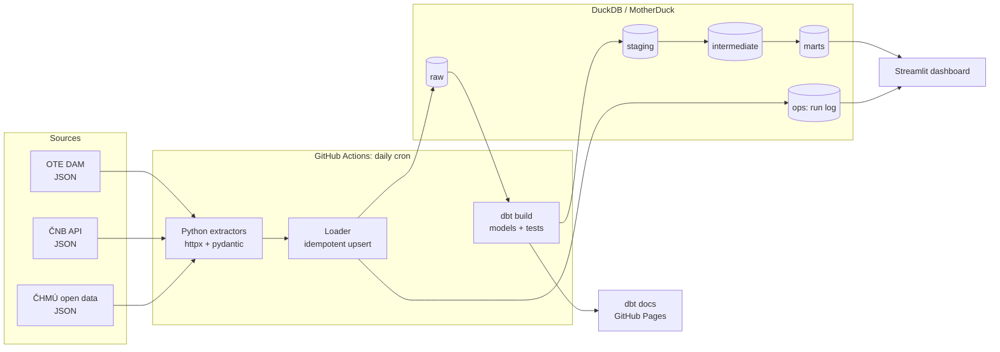

# Czech Energy Data Pipeline: архитектура и план

## 1. Что мы строим

Production-like пайплайн данных, который **каждый день сам** собирает данные чешского энергорынка, складывает их в аналитическое хранилище, преобразует через dbt в чистые витрины, проверяет качество данных и показывает результат на публичном дашборде.

**Бизнес-вопросы, на которые отвечает система:**

- Сколько стоит электроэнергия в Чехии завтра, по 15-минутным интервалам, в EUR и CZK?
- Как цена зависит от погоды: солнца (солнечная генерация), ветра, температуры (отопление)?
- Где пиковые и «отрицательные» часы, как меняется спред peak/off-peak, как цена ведёт себя по дням недели и сезонам?
- Насколько свежие и корректные данные (страница Data Quality прямо в дашборде)?

**Что это доказывает работодателю:** ETL на Python, моделирование данных (staging → intermediate → marts, звёздная схема), SQL, dbt (тесты, документация, инкрементальные модели), CI/CD на GitHub Actions, качество данных и наблюдаемость. Плюс знание предметной области: DAM, SDAC, 15-минутный MTU, CET/CEST, ČNB fixing.

## 2. Источники данных (проверено 2026-10-22)

| Источник | Что берём | Как | Особенности |
|---|---|---|---|
| **OTE, a.s.** (ote-cr.cz) | Результаты денного рынка (DAM): цена EUR/MWh и объём MWh | JSON `…/kratkodobe-trhy/elektrina/denni-trh/@@chart-data?report_date=YYYY-MM-DD` (запасной вариант: XLSX-отчёты OTE) | С 1.10.2025 рынок работает в **15-минутных** интервалах: 96 точек в день, 92 или 100 в дни перехода на летнее/зимнее время. Время локальное (Europe/Prague). Результаты публикуются около 13:00 CET за следующий день. Endpoint неофициальный, поэтому парсер должен падать громко, если формат поменяется |
| **ČNB** | Официальный курс EUR/CZK (и, при желании, USD/CZK) | REST `https://api.cnb.cz/cnbapi/exrates/daily?date=YYYY-MM-DD&lang=EN` | Публикуется по рабочим дням после 14:30. На выходные и праздники курса нет, используем последний действующий курс (forward-fill в dbt) |
| **ČHMÚ** open data | 10-минутные наблюдения метеостанций: температура, ветер, солнечное сияние, осадки | `https://opendata.chmi.cz/meteorology/climate/now/data/10m-<WSI>-<YYYYMMDD>.json` + метаданные станций в `…/now/metadata/` | В `now/` лежат только **последние ~3 дня**: если пропустить запуск, данные пропадут. Для бэкфилла используем `recent/` и `historical/`. Берём 6–10 репрезентативных станций (Praha, Brno, Ostrava, Plzeň, České Budějovice и т.д.) |

## 3. Архитектура



### 3.1 Технологический стек

| Слой | Выбор | Почему |
|---|---|---|
| Язык | Python 3.12, менеджер `uv` | Быстро, воспроизводимо, стандарт 2026 года |
| HTTP и валидация | `httpx` + `tenacity` (ретраи) + `pydantic` (схемы ответов) | Контракт на входе: если API поменяет формат, увидим это сразу, а не в дашборде |
| Хранилище | **DuckDB** локально + **MotherDuck** (облачный DuckDB, free tier) в проде | Ноль инфраструктуры. GitHub Actions пишет, Streamlit Cloud читает одну и ту же базу. Тот же SQL-диалект локально и в облаке |
| Трансформации | `dbt-core` + `dbt-duckdb`, пакеты `dbt_utils`, `dbt_expectations` | Основная «звезда» проекта |
| Оркестрация | GitHub Actions (cron + workflow_dispatch с параметром даты) | Бесплатно, прозрачно, видно в репозитории |
| Качество кода | `ruff`, `pytest`, `sqlfluff`, `pre-commit` | Всё прогоняется в CI на каждый PR |
| Дашборд | Streamlit + Plotly, деплой на Streamlit Community Cloud | Публичная ссылка для резюме |

> **Альтернатива: PostgreSQL** (Neon или Supabase, free tier). Выглядит «энтерпрайзнее», но требует сервер, миграции и `dbt-postgres`. Архитектура почти не меняется: меняется только adapter и loader. Рекомендую DuckDB + MotherDuck, а в README отдельно объяснить этот выбор: умение обосновать решение ценится на собеседовании.

### 3.2 Слои данных

**`raw`**: данные как пришли, плюс технические колонки. Пишет только Python.

- `raw.ote_dam_results`: report_date, period (1..100), price_eur_mwh, volume_mwh, `_ingested_at`, `_source_url`, `_payload_hash`
- `raw.cnb_fx_rates`: valid_for, currency_code, amount, rate, `_ingested_at`
- `raw.chmi_observations`: station_id, element, observed_at_utc, value, flag, `_ingested_at`
- `raw.chmi_stations`: метаданные станций (координаты, высота, название)
- `ops.pipeline_runs`: run_id, source, business_date, status, rows, duration, error

Загрузка **идемпотентна**: перезапуск за ту же дату делает `DELETE + INSERT` по ключу (source, business_date). Так безопасны ретраи и бэкфилл.

**`staging`** (dbt, view): одна модель на одну сырую таблицу. Переименование, типы, единицы измерения, таймзоны (локальное время Europe/Prague → UTC + local), дедупликация.

- `stg_ote__dam_prices`, `stg_cnb__fx_rates`, `stg_chmi__observations`, `stg_chmi__stations`

**`intermediate`** (dbt, ephemeral/view): бизнес-логика.

- `int_fx_rates_daily_filled`: календарь × курс с forward-fill на выходные и праздники
- `int_dam_prices_czk`: 15-минутные цены, пересчитанные в CZK/MWh
- `int_weather_hourly_cz`: 10-минутные наблюдения → часовые агрегаты по станциям → среднее по ЧР

**`marts`** (dbt, table/incremental): то, что читает дашборд.

- `dim_date`: календарь, выходные, чешские госпраздники, сезон
- `dim_station`: станции с координатами
- `fct_dam_price_15min`: зерно = один 15-минутный интервал (incremental)
- `fct_dam_price_hourly`: агрегация до часа для сравнения с историей до 10/2025
- `fct_daily_market_summary`: base/peak/off-peak, min/max, спред, число отрицательных интервалов, курс, средняя погода
- `mart_price_vs_weather`: часовая цена + температура/ветер/солнце для анализа корреляций

### 3.3 Качество данных

| Уровень | Проверка |
|---|---|
| Python (на входе) | pydantic-схема ответа; непустой ответ; ожидаемое число интервалов |
| dbt source freshness | OTE: данные на завтра есть (warn 1 день, error 2 дня); ČNB: курс не старше 4 дней; ČHMÚ: наблюдения не старше 1 дня |
| dbt generic tests | `unique`, `not_null`, `relationships`, `accepted_values` |
| dbt_expectations | цена в диапазоне гармонизированных лимитов SDAC (−500…+4000 EUR/MWh); курс EUR/CZK в разумных пределах (20…30); температура −40…+45 °C |
| Кастомные singular tests | ровно 96/92/100 интервалов в сутки (с учётом DST); нет пропусков дат в `fct_daily_market_summary`; у каждой цены есть курс |
| Наблюдаемость | `ops.pipeline_runs` + результаты `dbt build` (run_results.json) → страница Data Quality в дашборде; упавший workflow = письмо от GitHub |

### 3.4 CI/CD

- **`ci.yml`** (на каждый push/PR): `ruff` → `pytest` (на сохранённых фикстурах, без сети) → `sqlfluff lint` → `dbt build --target ci` на локальной DuckDB с seed-данными.
- **`daily.yml`** (cron `0 14 * * *` UTC, то есть 15:00 CET / 16:00 CEST, когда OTE и ČNB уже опубликованы, + ручной запуск с датой): extract → load → `dbt source freshness` → `dbt build --target prod` → загрузка артефактов dbt.
- **`docs.yml`**: `dbt docs generate` → GitHub Pages (lineage-граф будет виден прямо по ссылке).
- Секреты: `MOTHERDUCK_TOKEN` в GitHub Secrets и в настройках Streamlit Cloud (read-only токен).

### 3.5 Дашборд (Streamlit)

1. **Завтра**: 15-минутный график цены (EUR/CZK переключатель), min/max/среднее, отрицательные интервалы.
2. **История**: тренд base/peak, тепловая карта «час × день недели», сравнение месяцев.
3. **Цена vs погода**: scatter цена–солнце, цена–ветер, цена–температура, корреляции по сезонам.
4. **Data Quality**: последние запуски, свежесть каждого источника, результаты dbt-тестов.

## 4. Структура репозитория

```
czech-energy-pipeline/
├── .github/workflows/         ci.yml, daily.yml, docs.yml
├── src/energy_pipeline/
│   ├── extract/               ote.py, cnb.py, chmi.py
│   ├── load/                  duckdb_loader.py
│   ├── models/                pydantic-схемы ответов API
│   ├── config.py              настройки (pydantic-settings, .env)
│   └── cli.py                 `pipeline run --date`, `pipeline backfill --from --to`
├── dbt/
│   ├── models/staging/ intermediate/ marts/
│   ├── tests/                 singular tests
│   ├── seeds/                 czech_holidays.csv, stations_selected.csv
│   ├── macros/
│   ├── dbt_project.yml, packages.yml, profiles.yml
├── dashboard/                 app.py + pages/
├── tests/                     pytest + fixtures/ (реальные сохранённые ответы API)
├── docs/                      PLAN.md, sources.md, decisions.md (ADR)
├── data/                      локальная DuckDB (в .gitignore)
├── pyproject.toml, uv.lock, .pre-commit-config.yaml, .env.example
└── README.md                  на английском, для рекрутеров
```

## 5. Пошаговый план

Каждый этап заканчивается рабочим состоянием и отдельным осмысленным коммитом (или PR).

### Этап 0. Фундамент (~0.5 дня)
- `uv init`, `pyproject.toml`, Python 3.12, `ruff`, `pytest`, `pre-commit`, `.env.example`.
- Создать публичный репозиторий на GitHub, первый коммит.
- **Готово, когда:** `uv run pytest` и `pre-commit run --all-files` проходят.

### Этап 1. Разведка источников (~0.5–1 день)
- Скачать по 2–3 реальных ответа каждого API (включая DST-день и выходной для ČNB) в `tests/fixtures/`.
- Описать в `docs/sources.md` форматы, коды элементов ČHMÚ, ID станций, время публикации.
- **Готово, когда:** все форматы задокументированы, выбран список станций.

### Этап 2. Extractors + raw-загрузка (~2 дня)
- По порядку от простого к сложному: ČNB → OTE → ČHMÚ.
- `httpx` + ретраи, pydantic-валидация, идемпотентный loader в DuckDB, запись в `ops.pipeline_runs`.
- Тесты на фикстурах (`respx` для мока HTTP), включая DST и пустые ответы.
- **Готово, когда:** `uv run pipeline run --date 2026-10-21` наполняет `raw.*` локально, повторный запуск не создаёт дублей.

### Этап 3. Бэкфилл истории (~1 день)
- `pipeline backfill --from 2024-01-01 --to today` с паузами между запросами (вежливо к API).
- ČHMÚ-история через `recent/` и `historical/`.
- **Готово, когда:** в базе ~2+ года истории (часовые цены до 10/2025, 15-минутные после).

### Этап 4. dbt-модели (~3 дня)
- Sources + freshness → staging → intermediate → marts, seeds с чешскими праздниками.
- Инкрементальная `fct_dam_price_15min`, документация каждой колонки в `.yml`.
- **Готово, когда:** `dbt build` зелёный, `dbt docs` показывает полный lineage.

### Этап 5. Тесты качества данных (~1 день)
- Generic + dbt_expectations + singular tests из раздела 3.3.
- Намеренно «сломать» данные и убедиться, что тесты падают.
- **Готово, когда:** каждая модель в marts покрыта тестами, freshness настроен.

### Этап 6. Продакшн-хранилище и оркестрация (~1 день)
- Аккаунт MotherDuck, target `prod` в `profiles.yml`.
- `ci.yml`, `daily.yml`, `docs.yml`, секреты.
- **Готово, когда:** ежедневный запуск 3 дня подряд проходит без ручного вмешательства.

### Этап 7. Дашборд (~2 дня)
- 4 страницы из раздела 3.5, кэширование запросов (`st.cache_data`).
- Деплой на Streamlit Community Cloud.
- **Готово, когда:** публичная ссылка открывается и показывает данные на завтра.

### Этап 8. Упаковка для портфолио (~1 день)
- README на английском: проблема → архитектурная схема → стек → скриншоты → как запустить → решения и компромиссы.
- Бейджи CI, ссылки на дашборд и dbt docs, `docs/decisions.md` (почему DuckDB, почему 15-минутное зерно и т.д.).
- **Готово, когда:** незнакомый человек за 2 минуты понимает, что это, и может запустить локально одной командой.

**Итого:** около 12–14 рабочих дней в спокойном темпе.

## 6. Возможные расширения (после MVP)

- ENTSO-E Transparency: нагрузка и генерация по типам в CZ (нужен бесплатный API-токен), что даёт объяснение цен через солнце/ветер в Германии.
- Сравнение с соседними зонами (DE-LU, AT, SK, PL) через тот же SDAC.
- Простой прогноз цены (baseline + gradient boosting) как отдельная витрина.
- Алерты в Telegram при отрицательных ценах на завтра.

## 7. Принципы работы

- Маленькие осмысленные коммиты в стиле Conventional Commits (`feat:`, `fix:`, `chore:`…), без упоминаний AI-инструментов.
- Секреты только в `.env` / GitHub Secrets, никогда в коде.
- Всё, что падает, падает громко: лучше красный workflow, чем тихо неверные данные в дашборде.
